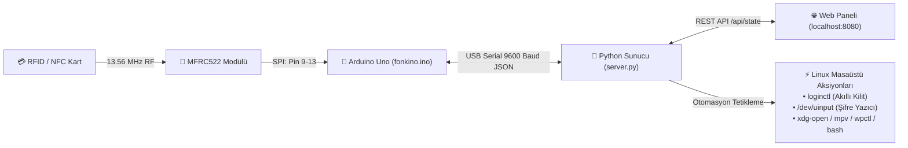

# Fonkino — Arduino & RC522 RFID Bilgisayar Otomasyon ve Akıllı Kilit Sistemi

**Fonkino**, Arduino (Uno / Nano / Mega) ve **MFRC522 (13.56 MHz RFID/NFC)** okuyucu modülünü kullanarak bilgisayarınıza fiziksel kartlarla veya anahtarlıklarla komut vermenizi, ekran kilidini açıp kapatmanızı, şifre girmenizi, uygulama/URL başlatmanızı ve kart çiplerinin derin teknik analizini (`SAK`, `RATS/ATS`, `EMV PPSE`, `MIFARE Blok 0/4`) yapmanızı sağlayan gerçek zamanlı bir web kontrol ve otomasyon sistemidir.

---

## ✨ Temel Özellikler

* **📡 Okununca Otomatik Kayıt (Auto-Register):** Yeni bir RFID kart veya anahtarlık yaklaştırıldığında UID otomatik olarak algılanır, sesli uyarı verilir ve web panelindeki listeye eklenir.
* **🔐 Akıllı Kilit (Smart Lock Toggle):**
  * Bilgisayar **açıkken** kartı okuttuğunuzda ekranı anında **kilitler** (`loginctl lock-session`).
  * Bilgisayar **kilitliyken** kartı tekrar okuttuğunuzda oturum kilidini anında **açar** (`loginctl unlock-session` / isteğe bağlı şifre doğrulaması).
* **⌨️ Donanımsal Sanal Klavye ile Şifre / Metin Girişi (`/dev/uinput`):**
  * Linux çekirdeği `evdev / uinput` altyapısını kullanarak Wayland ve X11 üzerinde (kilit ekranları, terminal `sudo` istemleri ve tarayıcılar dahil) gerçek bir USB klavye gibi şifrenizi yazıp `Enter` tuşuna basar.
* **⚡ Hazır Bilgisayar Fonksiyonları:**
  * 🌐 **Web Sitesi / URL Aç** (`xdg-open`)
  * 🎵 **Müzik / Ses Çal - Durdur (Toggle)** (`mpv` / `paplay`)
  * 🔔 **Masaüstü Bildirimi Gönder** (`notify-send`)
  * 🔇 **Sistem Sesini Kapat / Aç (Mute Toggle)** (`wpctl`)
  * 🔊 **Sistem Ses Seviyesini Ayarla (%)** (`wpctl`)
  * 🚀 **Uygulama Başlat** (Dosya yöneticisi, tarayıcı, kod editörü, terminal vb.)
  * 🔗 **HTTP Webhook / API İsteği Gönder** (`POST JSON`)
  * 💻 **Özel Terminal / Bash Komutu Çalıştır**
* **🔍 Derin Çip & EMV / Sektör Analizcisi (`deepInspectCard`):**
  * Kartın `SAK` byte'ına göre donanım mimarisini (`NXP MIFARE Classic 1K/4K`, `Ultralight/NTAG`, `SmartMX Hibrit`, `ISO/IEC 14443-4`) tespit eder.
  * `ISO 14443-4` uyumlu akıllı kartlara `RATS (0xE0 0x50)` ve `EMV PPSE (2PAY.SYS.DDF01)` APDU sorgusu göndererek kartın açık **Uygulama Etiketini** (`VISA`, `MASTERCARD`, `TROY` vb.) ve **AID** bilgisini çözümler.
  * MIFARE kartlarda **Sektör 0 / Blok 0 (Üretici Bloğu)** ve **Sektör 1 / Blok 4 (Veri Bloğu)** HEX + ASCII dökümünü çıkarır.
* **🔄 Kesintisiz Otomatik Bağlantı &Maksimum Anten Gücü:**
  * Klon RC522 modüllerinde zayıf okuma sorununu önlemek için anten kazancı otomatik olarak **`48 dB` (`RxGain_max`)** seviyesine çıkarılır.
  * Kablo temassızlığı veya USB tak-çıkar durumlarında hem Arduino hem de Python sunucusu bağlantıyı otomatik olarak yeniden kurar.

---

## 🔌 Devre Bağlantı Şeması (Arduino Uno / Nano / Mega + RC522)

### 1. Pin Bağlantı Tablosu

| RC522 RFID Modül Pini | Arduino Uno / Nano Pini | Arduino Mega 2560 Pini | Fonksiyon / Açıklama |
| :--- | :--- | :--- | :--- |
| **SDA (SS)** | **Dijital Pin 10** | **Pin 53** *(veya kodda 10)* | SPI Slave Select (Chip Select) |
| **SCK** | **Dijital Pin 13** | **Pin 52** | SPI Saat Hattı (Clock) |
| **MOSI** | **Dijital Pin 11** | **Pin 51** | SPI Master Out Slave In |
| **MISO** | **Dijital Pin 12** | **Pin 50** | SPI Master In Slave Out |
| **IRQ** | *Boş Bırakılır* | *Boş Bırakılır* | **Hiçbir yere bağlanmaz** |
| **GND** | **GND** | **GND** | Toprak (Ortak GND) |
| **RST** | **Dijital Pin 9** | **Dijital Pin 9** | Modül Reset Pini *(Güç kısmındaki `RESET`'e **değil**!)* |
| **3.3V (VCC)** | **3.3V** | **3.3V** | **3.3V Güç Beslemesi** *(Kesinlikle 5V'a takmayın!)* |

---

### 2. Görsel ASCII Bağlantı Şeması (Arduino Uno & RC522)

```text
      +---------------------------------------+
      |              ARDUINO UNO              |
      |                                       |
      |  [POWER]                   [DIGITAL]  |
      |   IOREF                     Pin 13 o--+-----> SCK
      |   RESET (BOŞ KALACAK!)      Pin 12 o--+-----> MISO
      |   3.3V  o--------+          Pin 11 o--+-----> MOSI
      |   5V             |          Pin 10 o--+-----> SDA (SS)
      |   GND   o-----+  |          Pin 9  o--+-----> RST
      +---------------+--+--------------------+
                      |  |                            |  |  |  |  |
                      |  +-------------------------+  |  |  |  |  |
                      +-------------------------+  |  |  |  |  |  |
                                                |  |  |  |  |  |  |
                                                v  v  v  v  v  v  v
                                          +------------------------------+
                                          |    GND  3.3V RST SDA MOSI MISO SCK
                                          |     o    o    o   o   o    o    o
                                          |   (IRQ pini boş bırakılır)
                                          |
                                          |         RC522 RFID / NFC
                                          |          13.56 MHz MODÜL
                                          +------------------------------+
```

> [!WARNING]
> **Çok Önemli 3 Donanım Kuralı:**
> 1. **`RESET` ile `Pin 9` Karışıklığı:** Arduino Uno'nun `POWER` soketindeki `RESET` deliği tam `3.3V` deliğinin yanındadır. RC522'nin **`RST`** kablosunu güç tarafındaki `RESET` deliğine **değil**, karşı taraftaki **Dijital Pin 9**'a takın! (`POWER` tarafında sadece `3.3V` ve `GND` takılı olmalıdır.)
> 2. **Breadboard Kısa Devresi:** RC522 modülünü breadboard'a takarken 8 bacağın aynı dikey 5'li şeride gelmemesine dikkat edin; aksi halde `3.3V` ile `GND` kısa devre olur, RC522 üzerindeki kırmızı LED söner ve Arduino kilitlenir.
> 3. **Lehim Kontrolü:** RC522 paketinden çıkan header pinleri karta lehimlenmeden sadece deliklerden geçirilerek takılırsa SPI haberleşmesi kurulamaz (`Version: 0x00` veya `0xFF` döner).

---

## 🏗️ Sistem Mimarisi



---

## 🚀 Kurulum ve Çalıştırma

### 1. Gereksinimler
* **Donanım:** Arduino Uno (veya Nano/Mega) + MFRC522 RFID Modülü
* **Arduino Kütüphanesi:** `MFRC522`
* **Yazılım:** Python 3.8+ (Standart kütüphane ile çalışır; sanal klavye özelliği için isteğe bağlı `python-evdev`)

### 2. Arduino Kodunu Derleme ve Yükleme (`arduino-cli`)

```bash
# Arduino AVR çekirdeğini ve MFRC522 kütüphanesini kurun
arduino-cli core update-index
arduino-cli core install arduino:avr
arduino-cli lib install MFRC522

# Kodu derleyin ve /dev/ttyUSB0 portundaki Arduino Uno'ya yükleyin
arduino-cli compile --fqbn arduino:avr:uno ./fonkino
arduino-cli upload -p /dev/ttyUSB0 --fqbn arduino:avr:uno ./fonkino
```

### 3. Web Sunucusunu Başlatma

```bash
python3 server.py
```

Sunucu başladığında tarayıcınızdan şu adrese gidin:
👉 **http://localhost:8080**

*(Portu değiştirmek isterseniz `RFID_PORT=8090 python3 server.py` şeklinde başlatabilirsiniz.)*

---

## 📡 Seri Port JSON Protokolü (`9600 Baud`)

Arduino ve Python sunucusu birbirleriyle satır bazlı JSON mesajları ile haberleşir:

* **Periyodik Donanım Durumu (`status`):**
  ```json
  {"event":"status","version":"0x92","antenna":"0x83","ok":true,"uptime":120}
  ```
* **Kart Okuma Olayı (`card`):**
  ```json
  {"event":"card","uid":"AA:BB:CC:DD","cardType":"MIFARE 1KB","sak":8}
  ```
* **Derin Çip & EMV/Sektör Analizi (`inspect`):**
  ```json
  {"event":"inspect","uid":"AA:BB:CC:DD","sak":"0x08","uidSize":4,"chipArch":"NXP MIFARE Classic 1K (1024 Byte, 16 Sektor)","block0":"AA BB CC DD ...","block4Hex":"00 00 ...","block4Ascii":"","atsHex":"","emvHex":"","emvAscii":""}
  ```
* **Bilgisayardan Arduino'ya Gönderilebilen Seri Komutlar:**
  * `STATUS` veya `JSON`: Anlık donanım durumunu JSON olarak döndürür.
  * `INIT` veya `RESET`: RC522 çipini yeniden başlatır ve anten kazancını maksimuma (`48 dB`) ayarlar.
  * `SIM:AA:BB:CC:DD`: Fiziksel kart olmadan donanım üzerinden kart okuma simülasyonu tetikler.

---

## 📂 Proje Dizin Yapısı

```text
fonkino/
├── fonkino/
│   └── fonkino.ino       # Arduino IDE uyumlu ana firmware dosyası
├── rfid-test.ino         # Kök dizin arduino-cli derleme dosyası
├── server.py             # Python HTTP + Seri Port Köprüsü ve Otomasyon Sunucusu
├── web/
│   └── index.html        # Gerçek zamanlı Web Kontrol Paneli (HTML5/CSS3/JS)
├── cards.example.json    # Örnek kart yapılandırma şablonu
├── .gitignore            # Kişisel kart verilerini (cards.json) hariç tutar
├── LICENSE               # MIT Lisansı
└── README.md             # Dokümantasyon ve Bağlantı Şeması
```

---

## 📄 Lisans

Bu proje [MIT Lisansı](LICENSE) altında lisanslanmıştır.
